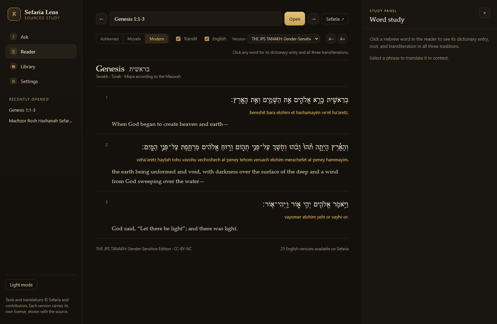

# Sefaria Lens


A desktop study app that reads the [Sefaria](https://www.sefaria.org) library and brings several study tools together in one place:

1. **Questions answered with primary sources** — you ask a question, the app searches Sefaria, orders what it finds by reading tier (Tanakh, Mishnah, Talmud first, then their commentaries, then Jewish thought and Mussar), reads the candidates, and returns a short synthesis plus the actual texts, each with a tier badge and a justification for why it was chosen.
2. **Transliteration in three traditions** — Ashkenazi, Mizrahi, and Modern Israeli, generated locally by a rules engine and switchable while you read.
3. **Word-by-word study** — click any Hebrew word for its BDB/Jastrow dictionary entry, root, morphology, and all three transliterations, plus a context-aware gloss for that verse.
4. **Selection tools** — select a phrase and translate it in context, transliterate it, or search the library for it.
5. **Library browsing** — the whole Sefaria table of contents (6,600+ works) as a category tree with a filter, opening any work at its first real section. Complex works such as siddurim and machzorim resolve through their schema rather than a guessed chapter. A breadcrumb in the reader and a trail in the library walk back up the shelf (Genesis 1 → Torah → Tanakh → All works).
6. **English where Sefaria has none** — when a segment of an edition is published without an English translation, the app generates one for the gaps, labels it clearly as an AI translation, and caches it.
7. **Commentaries, verse by verse** — every verse of a primary source carries its own chooser listing only the works Sefaria links to *that verse* (Rashi, Ramban, Ibn Ezra, Midrash, Targum, halakhic codes, later thought as relevant), grouped and ordered the way Sefaria's own list is. Picking one shows it under that verse alone, Hebrew and English with its license. The whole commentary layer can be switched off from the reader bar.

Texts, translations, links, and lexicon entries come from the public Sefaria API. The AI layer is provider-agnostic and optional for reading (required for Q&A and translation).

## Run it

**Prebuilt app** (Windows x64): download `SefariaLens-1.0.0-portable.exe` from the **Releases** page of this repository. Double-click it; no installation or admin rights are required. The portable build unpacks to a temp folder at launch.

**From source** (Node 18+):

```bash
npm install
npm start          # Electron window
npm run dev        # browser harness at http://127.0.0.1:4173
npm test           # node:test suites, no network or API key needed
npm run dist       # build dist/SefariaLens-1.0.0-portable.exe
```

`npm run dev` serves the same UI and RPC service over HTTP, which is handy for working on the interface without rebuilding the desktop app. The test suite uses a bundled mock OpenAI-compatible server (`test/mock-llm.js`), so no provider key is required to run it.

### Screenshots

| Reader | Word study | Verse commentaries |
| --- | --- | --- |
|  |  |  |

## First run

On the first launch the app opens a setup assistant: pick a provider, paste a key, and either **Save and start** or **Save and test** (which confirms the provider before closing). **Skip for now** dismisses it for good — reading, search, and transliteration need no provider. Nothing is asked again until you change it, and **Settings → Run setup assistant** reopens the same panel at any time. Escape closes it without recording a choice, so it returns on the next launch.

The key is written to the app's own settings file, encrypted with the OS keychain where available, and never sent anywhere except the chosen provider.

## Connecting an AI provider

Open **Settings → AI provider** and pick one:

| Provider | Notes |
| --- | --- |
| OpenAI | default model `gpt-4o-mini` |
| OpenRouter | one key for many models |
| Groq | fast, cheap open models |
| Ollama | fully local; the app detects the server, lists installed models, no key needed |
| OpenLLM | gateway for multiple providers ([openllm.sh](https://openllm.sh)) |
| Custom | any OpenAI-compatible `/chat/completions` endpoint |

The key is stored on this machine, encrypted with the OS keychain via Electron `safeStorage` when available. It is never sent anywhere except your chosen provider. **Test connection** verifies it before you rely on it.

### Local models (Ollama)

Picking **Ollama** in Settings or in the setup assistant asks the service what is actually installed and answers before you save: the model field is filled with an installed model (and offers the rest as suggestions), the API key is disabled, and the panel reports either readiness or the exact next step — “not answering at `http://localhost:11434/v1`”, “has no models installed”, or “`llama3.1` is not installed, run `ollama pull llama3.1`”. **Check local model** re-runs that check after you start the server or pull a model.

Local inference gets a five-minute request timeout instead of the cloud's sixty seconds. If a server rejects `response_format`, the client retries without it, and a reply that is not valid JSON gets one repair turn before failing. When ranking does fail, the answer still appears with Sefaria's own ordering and a caveat naming the provider, rather than an empty page.

A local model also gets a smaller ranking prompt: six passages clipped shorter than the twelve a cloud model reads, plus a tighter answer budget. On a CPU-only 8B model (`llama3.1:8b` on this machine) a sourced answer takes roughly one to two and a half minutes; the first answer after a model load is the slowest. Because a local plan can consist of four long phrases that Sefaria's lexical search cannot match, two single-word fallbacks are always reserved among the search queries.

While a question runs, **Stop** cancels it: the renderer sends `ask.cancel` with the request id, the service aborts the model call, and the UI settles at once with a *Cancelled* card — even if a Sefaria fetch was still in flight. The abandoned fetch finishes in the background and its result is discarded.

### Making local answers faster

Ollama only uses the Radeon 780M's Vulkan backend when integrated GPUs are enabled. Without `OLLAMA_IGPU_ENABLE=1`, the log says *“dropping integrated GPU”* and inference runs on the CPU. With it set, `ollama ps` reports the model in VRAM and generation roughly doubles. In PowerShell:

```powershell
setx OLLAMA_IGPU_ENABLE 1
```

Then restart Ollama (quit it from the tray and start it again, or sign out). The rest of the speed comes from the app: enough retrieval to keep quality (six passages, shorter clips) without sending a cloud-sized prompt to a local model. Measured here: 154 s for the first answer, about 60–70 s warm with the iGPU, versus several minutes on CPU alone. A 3B model is roughly twice as fast again, with weaker source selection.

Search, reading, transliteration, and the lexicon work with no key. Without one, Q&A returns lexical search results labelled as unranked — never canned prose — and offers a link to Settings. On a test machine, point the provider at the bundled mock (`node test/mock-llm.js`, then a Custom provider on `http://127.0.0.1:4199/v1`); its justifications are labelled as mock output and its gloss echoes the word it was asked about, so a test double can never be mistaken for a real answer.

## How a question is answered

```
question
  → LLM proposes 2–4 library search queries (English + Hebrew terms); keyword
    fallbacks (stopword-stripped terms and pairs) are queued behind them, so a
    failed or weak plan still retrieves — Sefaria's search is lexical and a
    whole question such as "caring for strangers" matches nothing
  → Sefaria /api/search-wrapper runs them in parallel
  → hits are merged by ref, scored, and tagged with a reading tier from the
    table of contents (no extra request: 6,600 works are mapped once)
  → a shortlist of 18 keeps the tier order but reserves slots per tier, so
    commentary is not crowded out by twenty mediocre primary hits
  → the shortlisted passages are fetched in both Hebrew and English, re-tiered
    from their own categories, and passages whose own text never mentions the
    question's terms are dropped when enough on-topic candidates remain
  → LLM selects 1–4 relevant passages, writes the synthesis, and justifies each
    pick; a repeated boilerplate justification is replaced with a grounded note
    naming the ref, the matched terms, and the passage's own words
  → response carries refs, both languages, transliterations, justifications,
    confidence, and run metadata (queries used, passages read, elapsed)
```

Grounding rules in the prompt: use only the supplied candidates, never invent a reference, quote the source's own words, return an empty list rather than loosely related passages, and never reuse one justification across sources. Source indexes returned by the model are validated against the candidate list; invalid picks are dropped, not trusted. If the model or provider fails, the app falls back to term overlap and tier ranking and labels the result as unranked. That fallback is lexical, so it is honest but blunt: it can surface a verse that merely contains the word.

### Reading tiers

| tier | what falls in it |
| --- | --- |
| **Primary source** | Tanakh, Mishnah, Talmud |
| **Commentary** | works that explain them — Rashi, Ramban, Ibn Ezra, Tosafot, Midrash, Targum, halakhic codes, and anything whose category path names a commentary genre |
| **Jewish thought / Mussar** | Jewish Thought, Philosophy, Kabbalah, Chasidut, Musar |
| **Related text** | Liturgy, reference, responsa, and anything unclassified |

The tier is taken from the work's category path, not from its ref, so "Rashi on Genesis" (filed under Tanakh) is commentary while "Mishnah Avot" is primary. The model is told the priority order and asked to prefer the earliest tier that genuinely answers, and to say so when it answers from commentary because no primary source speaks to the question. Every source card carries its tier.

## Commentaries, verse by verse

Each verse of a primary source carries a small **✦ Commentaries** button. It asks Sefaria for the links on *that verse* ("Genesis 1:2"), so the chooser lists only works that actually comment on it — 239 for Genesis 1:2 — grouped by Sefaria's own categories (Commentary, Quoting Commentary, Midrash, Targum, Talmud, Halakhah, Kabbalah, Chasidut, Musar, Jewish Thought) and ordered inside each group by the classics first, then composition date, then coverage. Groups show eight works with a "+N more" expander, and the list scrolls inside the verse.

Choosing one fetches that work at that verse and shows it directly beneath the verse, Hebrew and English, with its license; clicking it again hides it. The **Commentaries** checkbox in the reader bar removes the whole layer — every button, chooser, and open commentary — in one move, and the setting is remembered.

Texts that are not addressed by chapter and verse (a Talmud daf, whose segments are its lines) get one chooser for the passage above the text instead, because there is no per-verse ref to link against. Works that are themselves commentary show no chooser.

## Transliteration

`src/translit.js` is a rules engine over pointed Hebrew. It parses letter clusters (consonant + niqqud, dagesh, shin/sin dot, cantillation ignored), resolves matres lectionis, shva na/nach, dagesh qal/forte, furtive patach, and qamatz qatan, then applies a pronunciation profile:

| feature | Modern Israeli | Ashkenazi | Mizrahi |
| --- | --- | --- | --- |
| qamatz gadol | a | o | a |
| cholam | o | ō | o |
| tzere | e | ey | e |
| vav | v | v | w |
| tav rafe | t | s | ṯ (plain t after a break) |
| qof | k | k | q |
| chet | ch | ch | ḥ |
| tet | t | t | ṭ |
| ayin | ' | ' | ʿ |
| tsadi | tz | tz | ṣ |
| bet/khaf/pe rafe | v/ch/f | v/ch/f | v/kh/f |
| gimel/dalet rafe | g/d | g/d | ḡ/ḏ |

Ashkenazi gives holam a macron so it is visibly distinct from qamatz: *toroh* (qamatz) against *tōroh* (holam). Mizrahi writes vav as **w** and bet, khaf and pe rafe with their plain sounds (**v, kh, f**) rather than ḇ ḵ p̱, which are hard to read at text size; gimel, dalet and tav keep their scholarly marks because those sounds remain distinct in the tradition. The emphatics are marked too (ṭ ṣ ḥ ʿ q). A letter that opens a word after a break keeps its plosive value even when the source writes no dagesh, as Masoretic reading requires — תֹהוּ is *tohu*, not *ṯohu* — so the mnemonic is "plain after a break, marked after a vowel". Turn off scholarly diacritics in Settings to drop ḥ ṣ ṭ ʿ q ṯ and the Ashkenazi macron.

Known limits, surfaced in the app: stress is not marked; shva defaults to nach except in high-confidence positions; qamatz qatan is detected where the source marks it (Sefaria's Miqra according to the Masorah does) or for a short list of frequent words; words with no niqqud at all are returned unchanged rather than guessed. It is a study aid, not an authoritative vocalization.

## Translations

The reader's **Translation** picker lists every non-Hebrew version Sefaria offers for the open passage, not only English: German, Russian, Portuguese, French, Spanish, Italian, Yiddish, Esperanto, Ladino and the rest. Sefaria files all of these as `language: "en"` and tags them in the title ("… [de]"), so the app reads the language from that tag, requests the version with the real language name (`german|Title`, `esperanto|Title`, `ladino|Title`), and labels the choice in the header and picker with a language pill. A tag the app does not recognise is still treated as non-English rather than silently asked for as English, so the failure is visible instead of blank. English stays the default.

Some versions are partial: Russian on Berakhot 2a covers one segment of fourteen. The footer states the coverage, the available text is shown where Sefaria places it, and the app never generates an English translation over a non-English selection. Choosing a version that has no text at the passage reports that plainly instead of leaving the page blank.

## Reading preferences

The reader bar carries three independent switches: **Translit**, **English**, and **Commentaries**. Each hides its layer completely — transliteration lines, translation blocks (including AI translations), or the whole commentary affordance — and the choice is saved in Settings, where the same defaults can be set before opening a book. The transliteration style buttons remain available while transliteration is off, so turning it back on applies the chosen tradition immediately.

## Project layout

```
electron/main.js     Electron window, IPC, encrypted key storage
electron/preload.js  contextBridge → window.sefariaLens.rpc
src/service.js       one RPC service used by Electron and the dev harness
src/sefaria.js       Sefaria client: texts, search, lexicon, links, TOC
src/answer.js        retrieval pipeline, prompts, gloss, selection and passage translation
src/llm.js           OpenAI-compatible client with typed errors
src/translit.js      Hebrew → Latin rules engine, three profiles
src/util.js          HTML/footnote stripping, segment normalisation, ref parsing
renderer/            plain HTML/CSS/JS UI (no build step)
tools/devserver.js   browser harness exposing the same RPC over HTTP
tools/shoot.js       offscreen Electron screenshot harness
build/icon.png       generated app icon (tools/make-icon.js)
test/                node:test suites + a mock OpenAI-compatible server
```

## Data and licensing

Sefaria's code is GPL-3.0, but **the texts and translations are licensed individually** — each version carries its own license (Public Domain, CC0, CC-BY, CC-BY-NC, …). Sefaria Lens displays the version title and license under each source. Commercial reuse of a passage may require checking that version's terms on Sefaria. This app is independent and not affiliated with Sefaria; "Sefaria" is their trademark.

Transliteration and the app's own code are original to this project and released under the [MIT License](LICENSE). Sefaria Lens is an independent project, not affiliated with Sefaria.

## Privacy

Questions go to your selected AI provider; passage text from Sefaria is included in the prompt. Sefaria receives only text/search requests. Nothing else leaves the machine. Responses are cached locally under the Electron user-data directory; delete that folder to clear it.

## Contributing

Issues and pull requests are welcome. Before sending a patch:

```bash
npm install
npm test
```

Codeberg runs the same suite through Woodpecker on every push and pull request ([.woodpecker.yml](.woodpecker.yml)). Please keep the tests green and add one for any behaviour change; the suites are plain `node:test`, so a new file in `test/` is enough. There is no build step for the renderer, and no linter is configured.
