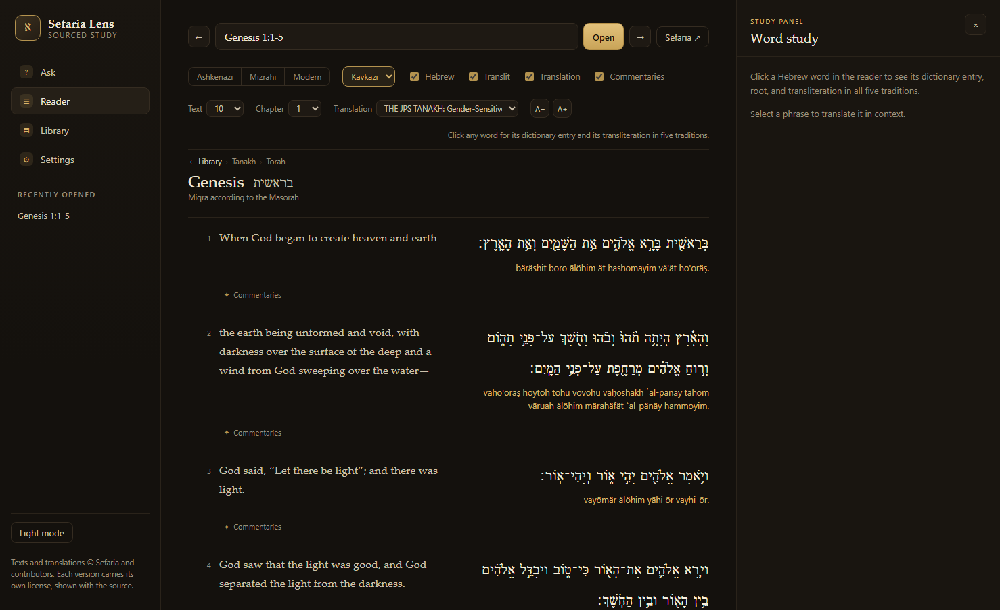
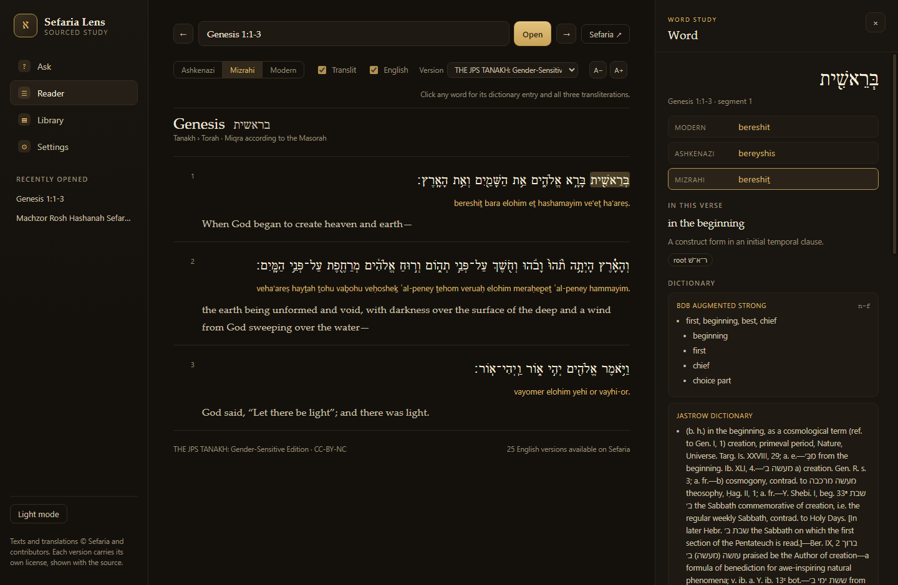
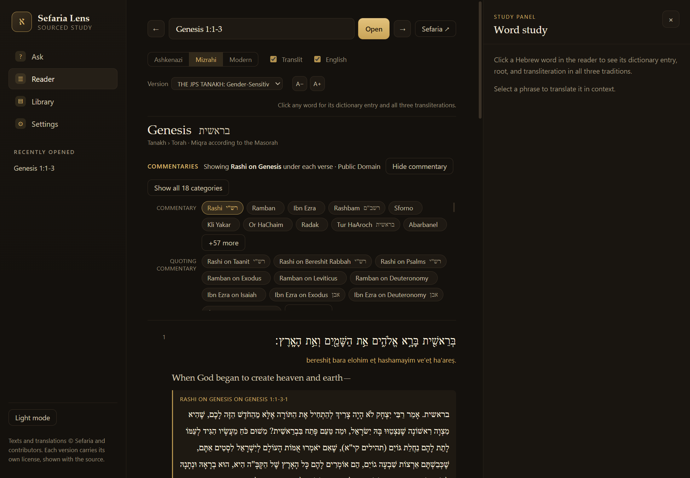
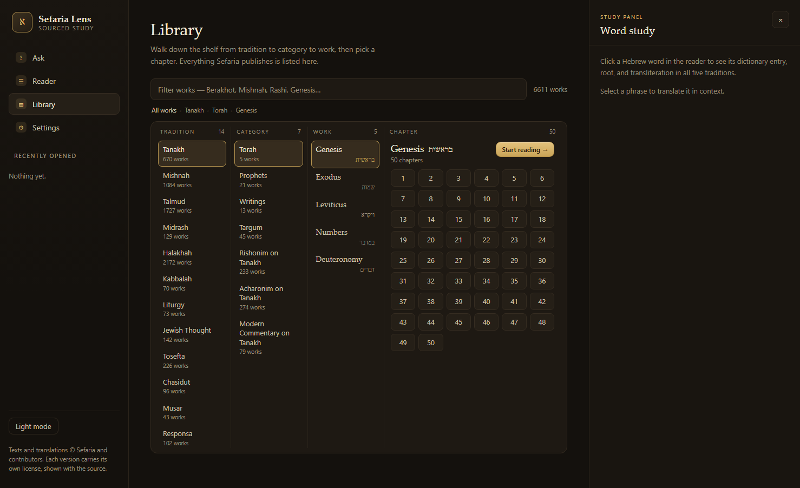
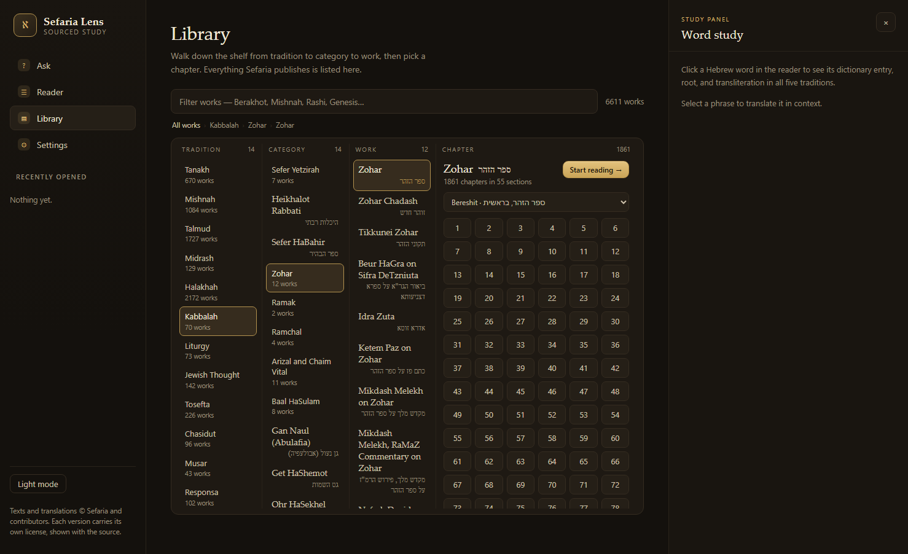
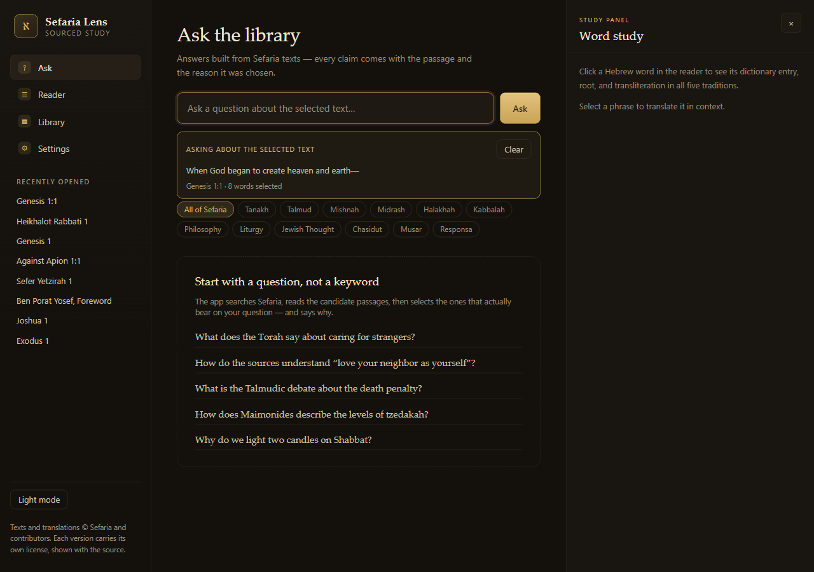
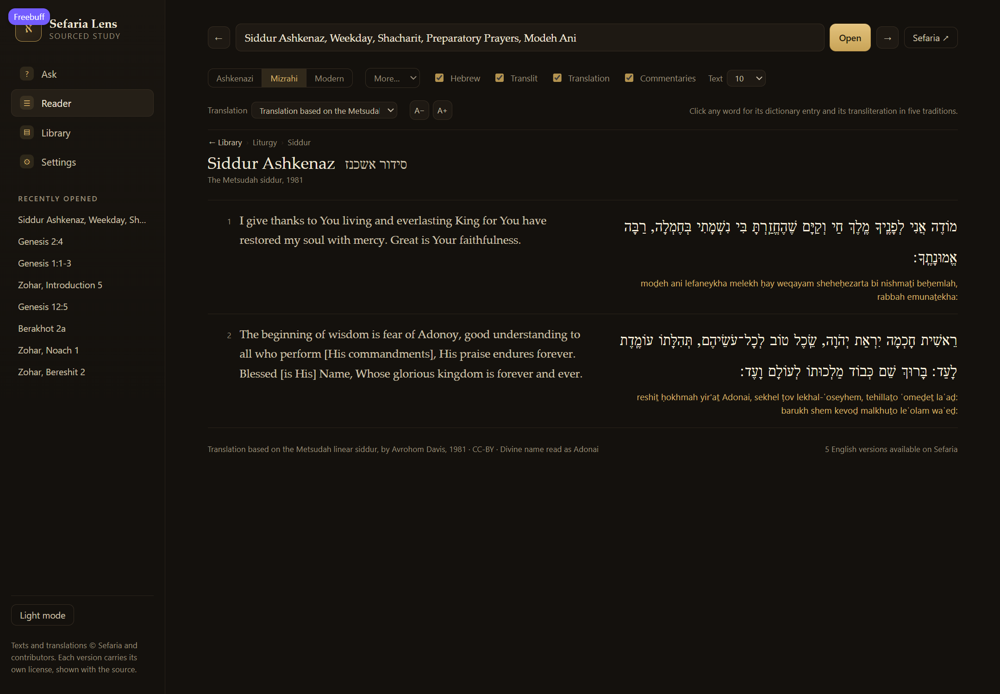

# Sefaria Lens


A desktop study app that reads the [Sefaria](https://www.sefaria.org) library and brings several study tools together in one place:

1. **Questions answered with primary sources** — you ask a question, the app searches Sefaria, orders what it finds by reading tier (Tanakh, Mishnah, Talmud first, then their commentaries, then Jewish thought and Mussar), reads the candidates, and returns a short synthesis plus the actual texts, each with a tier badge and a justification for why it was chosen.
2. **Transliteration in seven traditions** — Ashkenazi, Mizrahi, and Modern Israeli on the reader bar, with Yemeni, Kavkazi and two Ancient (Tiberian) schemes in a **More** menu beside them; generated locally by a rules engine and switchable while you read.
3. **Word-by-word study** — click any Hebrew word for its BDB/Jastrow dictionary entry, root, morphology, and its transliteration in every tradition, plus a context-aware gloss for that verse.
4. **Selection tools** — select a phrase and translate it in context, transliterate it, search the library for it, or **ask a question about it**. Asking carries the selection and its verse into retrieval, so a question like “who is speaking here?” lands on the right passage instead of a keyword search.
5. **Library search** — a dedicated view over Sefaria's full-text index, in Hebrew or English, with each passage listed once and opened in the reader. Limit a search to **Tanakh**, **Talmud**, or any other category, or to a single work — the one on screen, or any of the 6,600 in the library. **Search** in the selection toolbar sends the selected phrase straight there.
6. **Library browsing, down to the chapter** — the whole Sefaria table of contents (6,600+ works) as a shelf of columns: tradition, category, work, then a grid of that work's chapters, so Zohar opens where you want it instead of at page one. Complex works list their own sections (Zohar's 55 parashot, a siddur's services) above the chapter grid. The reader offers the same jump control beside the transliteration switches, so you can move chapter to chapter without going back to the library. A breadcrumb in the reader and a trail in the library walk back up the shelf (Genesis 1 → Torah → Tanakh → All works).
7. **English where Sefaria has none** — when a segment of an edition is published without an English translation, the app generates one for the gaps, labels it clearly as an AI translation, and caches it.
8. **Commentaries, verse by verse** — every verse of a primary source carries its own chooser listing only the works Sefaria links to *that verse* (Rashi, Ramban, Ibn Ezra, Midrash, Targum, halakhic codes, later thought as relevant), grouped and ordered the way Sefaria's own list is. Picking one shows it under that verse alone, Hebrew and English with its license. The whole commentary layer can be switched off from the reader bar.
9. **Read your way** — Hebrew and its translation sit side by side, verse by verse, with the original on the right and the translation on the left, so you read across rather than down. Hebrew, transliteration, translation, and commentaries are independent layers: turning Hebrew and Transliteration off gives an English-only page, including the answer cards, and the translation then takes the full width. A **Text** selector shows 10, 25, 50, or 100 segments at once (or the whole section), with **Show more** for the rest.

Texts, translations, links, and lexicon entries come from the public Sefaria API. The AI layer is provider-agnostic and optional for reading (required for Q&A and translation).

## Run it

**Prebuilt app** (Windows x64): download `SefariaLens-1.0.10-portable.exe` from the **Releases** page of this repository. Double-click it; no installation or admin rights are required. The portable build unpacks to a temp folder at launch. Each release publishes `SHA256SUMS.txt` next to the exe (`sha256sum -c SHA256SUMS.txt`).

**From source** (Node 18+):

```bash
npm install
npm start          # Electron window
npm run dev        # browser harness at http://127.0.0.1:4173
npm test           # node:test suites, no network or API key needed
npm run dist       # build dist/SefariaLens-1.0.10-portable.exe
```

`npm run dev` serves the same UI and RPC service over HTTP, which is handy for working on the interface without rebuilding the desktop app. The test suite uses a bundled mock OpenAI-compatible server (`test/mock-llm.js`), so no provider key is required to run it.

### Releases are built in CI

Pushing an annotated tag `v<version>` that matches `package.json` makes Woodpecker run the tests, package the portable exe on Linux through Wine (`electronuserland/builder:22-wine`), and upload the exe plus `SHA256SUMS.txt` to the Codeberg release. The release notes are the tag annotation itself, so `git tag -a v1.0.11 -F notes.md && git push origin v1.0.11` is the whole release procedure.

The upload step needs a `codeberg_release_token` repository secret; see [Continuous integration](#continuous-integration) for that and for enabling CI in the first place. Without the secret the tests and the build still run, and only the upload fails.

### Screenshots

| Reader: original and translation in parallel | Word study | Verse commentaries |
| --- | --- | --- |
|  |  |  |

| Library shelf | Zohar, by section and chapter |
| --- | --- |
|  |  |

Selecting a phrase adds **Translate**, **Transliterate**, **Search**, and **Ask** to the floating toolbar. **Ask** carries the selection, its reference, and the surrounding verse into the question:



## First run

On the first launch the app opens a setup assistant: pick a provider, paste a key, and either **Save and start** or **Save and test** (which confirms the provider before closing). **Skip for now** dismisses it for good — reading, search, and transliteration need no provider. Nothing is asked again until you change it, and **Settings → Run setup assistant** reopens the same panel at any time. Escape closes it without recording a choice, so it returns on the next launch.

The key is written to the app's own settings file, encrypted with the OS keychain where available, and never sent anywhere except the chosen provider.

## Connecting an AI provider

Open **Settings → AI provider** and pick one:

| Provider | Notes |
| --- | --- |
| OpenAI | default model `gpt-4o-mini` |
| OpenRouter | one key for many models |
| Groq | fast, cheap open models |
| Ollama | fully local; the app detects the server, lists installed models, no key needed |
| OpenLLM | gateway for multiple providers ([openllm.sh](https://openllm.sh)) |
| Custom | any OpenAI-compatible `/chat/completions` endpoint |
| Freebuff | local named pipe to a Freebuff worker; no key |

The key is stored on this machine, encrypted with the OS keychain via Electron `safeStorage` when available. It is never sent anywhere except your chosen provider. **Test connection** verifies it before you rely on it.

### Freebuff over a local pipe

Freebuff Desktop has no supported headless model API, so the app does not pretend it is one. Instead, **Settings → AI provider → Freebuff (local pipe)** sends each request to a named pipe:

- Windows: `\\.\pipe\sefaria-lens-freebuff`
- Linux/macOS: `$TMPDIR/sefaria-lens-freebuff.sock`

Start the worker that owns the other end:

```bash
npm run freebuff-fifo
```

The worker needs a route to Freebuff. The supported one is a running [freebuff-bridge](https://github.com/toyro396133/freebuff-bridge) (third-party) with a dedicated thread:

```bash
# PowerShell
$env:FREEBUFF_THREAD = "<thread id>"
$env:FREEBUFF_BRIDGE_URL = "http://127.0.0.1:7777"
npm run freebuff-fifo
```

If your bridge lives elsewhere, set `FREEBUFF_BRIDGE_TOKEN` as well. Alternatively, point `FREEBUFF_CMD` at any adapter that reads one JSON request from stdin and writes `{"text": "..."}` to stdout:

```bash
FREEBUFF_CMD="node my-freebuff-adapter.js" npm run freebuff-fifo
```

The pipe carries the same messages the app would send to any model, so a bridge thread sees the question and the candidate passages. The worker waits for the thread to go idle, then returns its last assistant message. Freebuff may still use its tools while answering; use a dedicated study thread so it cannot disturb other work.

This is a local-only integration: the pipe is on loopback, no Freebuff token is stored by the app, and the bridge is not bundled. The worker lives in `tools/freebuff-fifo.js`, so it is available from a source checkout (`npm run freebuff-fifo`); the portable build does not ship a Node runtime for it. If the pipe or bridge is down, Ask says so and returns unranked Sefaria passages rather than switching to another provider behind your back.

### Local models (Ollama)

Picking **Ollama** in Settings or in the setup assistant asks the service what is actually installed and answers before you save: the model field is filled with an installed model (and offers the rest as suggestions), the API key is disabled, and the panel reports either readiness or the exact next step — “not answering at `http://localhost:11434/v1`”, “has no models installed”, or “`llama3.1` is not installed, run `ollama pull llama3.1`”. **Check local model** re-runs that check after you start the server or pull a model; the check itself is cached for twenty seconds, and a dead server is backed off rather than polled, so looking at Settings twice is not two probes.

Ollama is spoken to over its **native API** (`/api/chat`), not the OpenAI-compatible shim, because only the native API can say how much context to reserve (`options.num_ctx`), how long to keep the model in memory (`keep_alive`), how much to generate (`num_predict`), what shape the JSON must take (a schema passed as `format`), and how long each phase actually took. A proxy labelled “ollama” that does not answer `/api/version` falls back to the OpenAI-compatible path automatically.

**Nothing is generated because a page opened.** An edition that Sefaria publishes without English used to trigger a translation on load; on a commentary with sixteen untranslated segments that was **135 s of inference before the page appeared, and the translation failed anyway**. Now the reader prints how many segments lack English and offers *Translate N segments with AI*; the button is the only trigger (or the *Translate untranslated passages as soon as they open* setting, off by default).

**One shared AI service, one model at a time.** Every request goes through `src/llm.js`: it serialises local inference (a second request waits; a flood is refused with a clear message instead of piling up), shares identical requests already in flight, keeps one context size for the session so the model is never reloaded at a new window size, and gives each kind of request its own output ceiling — a gloss cannot generate a paragraph, and a local model is capped at 320 tokens for an answer. Prompt size is fitted to the context window before sending, because Ollama silently drops the front of an over-long prompt (which would take the rules with it).

While a question runs, **Stop** cancels it: the renderer sends `ask.cancel` with the request id, the service aborts the model call, and the UI settles at once with a *Cancelled* card — even if a Sefaria fetch was still in flight. Ollama stops the generation too (its log shows the slot released at the abort). Reloading the window or closing the app cancels anything still running, rather than letting a minute of inference finish into nothing.

**Settings → Local model resources** holds the three knobs that decide what the model costs when idle: *Keep in memory* (`0`, 5 minutes, 15 minutes, 1 hour, or until unloaded), *Context window* (2048/4096/8192, one size for every task), and the auto-translate switch, plus *What is loaded?* (model, size, VRAM share, context — i.e. whether it is really on the GPU) and *Free memory now* (`keep_alive: 0`, which releases the 5 GB immediately).

### Making local answers faster

Ollama only uses the Radeon 780M's Vulkan backend when integrated GPUs are enabled. Without `OLLAMA_IGPU_ENABLE=1`, the log says *“dropping integrated GPU”* and inference runs on the CPU. With it set, `ollama ps` reports the model in VRAM and generation roughly doubles. In PowerShell:

```powershell
setx OLLAMA_IGPU_ENABLE 1
```

Then restart Ollama (quit it from the tray and start it again, or sign out). The rest of the speed comes from the app: enough retrieval to keep quality (six passages, shorter clips) without sending a cloud-sized prompt to a local model. Measured here on `llama3.1:8b` Q4_K_M, 100 % in VRAM, context 4096:

| | before | after |
| --- | --- | --- |
| Opening an untranslated passage | 135.5 s (translation failed) | 0.14 s |
| Clicking the same word twice | 10.6 s + 6.3 s, two generations | 10.6 s then 0 ms, one generation |
| A sourced answer, warm | 66.4 s, first word at 66.4 s | 47.6 s, first word at 26.5 s |
| Source-selection prompt | 5 017 chars | 4 926 chars, fitted to 3 680 tokens |
| Cold model load | 4.9 s | 4.9 s (reported as *Preparing…*) |

Generation runs at about 9.8 tokens/s and prompt evaluation at about 110 tokens/s on this iGPU, which is why prompt size — not output length — is the thing to watch. A 3B model is roughly twice as fast again, with weaker source selection.

### Local runtime and network exposure

Ollama listens on loopback only (`127.0.0.1:11434`). The desktop app calls it from Electron's main process, so no browser CORS policy is involved and no `OLLAMA_ORIGINS` setting is needed. The browser harness (`npm run dev`) is the one case where the page could call it directly, and it does not: it posts to its own `/rpc` endpoint on `127.0.0.1:4173`, which calls Ollama server-side. Nothing here is meant to be deployed publicly — do not put an Ollama port on a public interface, and do not run the dev harness on one. The harness also refuses `/rpc` and `/events` requests that do not come from its own page (wrong `Host`, a foreign `Origin`, or a body not declared as JSON), so another site open in the same browser cannot drive it.

Search, reading, transliteration, and the lexicon work with no key. Without one, Q&A returns lexical search results labelled as unranked — never canned prose — and offers a link to Settings. On a test machine, point the provider at the bundled mock (`node test/mock-llm.js`, then a Custom provider on `http://127.0.0.1:4199/v1`); its justifications are labelled as mock output and its gloss echoes the word it was asked about, so a test double can never be mistaken for a real answer.

## How a question is answered

```
question
  → LLM proposes 2–4 library search queries (English + Hebrew terms) and the
    1–2 refs most likely to answer it (e.g. Exodus 32:1-6); keyword fallbacks
    (stopword-stripped terms and pairs) are queued behind the queries, so a
    failed or weak plan still retrieves — Sefaria's search is lexical and a
    whole question such as "caring for strangers" matches nothing
  → the refs are fetched from Sefaria directly (an invented ref is simply
    skipped), and the two most distinctive keywords are also searched with
    filters: ["Tanakh"], so a translation that never uses the questioner's
    phrase — "golden calf" does not occur in Exodus 32 — cannot hide the Torah
    behind a later Talmudic or halakhic discussion
  → Sefaria /api/search-wrapper runs the queries in parallel
  → hits are merged by ref, scored, and tagged with a reading tier from the
    table of contents (no extra request: 6,600 works are mapped once)
  → a shortlist of 18 keeps the tier order but reserves slots per tier, so
    commentary is not crowded out by twenty mediocre primary hits
  → the shortlisted passages are fetched in both Hebrew and English, re-tiered
    from their own categories, and passages whose own text never mentions the
    question's terms are dropped when enough on-topic candidates remain
  → LLM selects 1–4 relevant passages, writes the synthesis, and justifies each
    pick; a repeated boilerplate justification is replaced with a grounded note
    naming the ref, the matched terms, and the passage's own words
  → response carries refs, both languages, transliterations, justifications,
    confidence, and run metadata (queries used, passages read, elapsed)
```

Grounding rules in the prompt: use only the supplied candidates, never invent a reference, quote the source's own words, return an empty list rather than loosely related passages, and never reuse one justification across sources. Source indexes returned by the model are validated against the candidate list; invalid picks are dropped, not trusted. If the model or provider fails, the app falls back to term overlap and tier ranking and labels the result as unranked. That fallback is lexical, so it is honest but blunt: it can surface a verse that merely contains the word.

### Reading tiers

| tier | what falls in it |
| --- | --- |
| **Primary source** | Tanakh, Mishnah, Talmud |
| **Commentary** | works that explain them — Rashi, Ramban, Ibn Ezra, Tosafot, Midrash, Targum, halakhic codes, and anything whose category path names a commentary genre |
| **Jewish thought / Mussar** | Jewish Thought, Philosophy, Kabbalah, Chasidut, Musar |
| **Related text** | Liturgy, reference, responsa, and anything unclassified |

The tier is taken from the work's category path, not from its ref, so "Rashi on Genesis" (filed under Tanakh) is commentary while "Mishnah Avot" is primary. Within the primary tier, a Tanakh verse retrieved for this question — or the passage the planner named — is placed before Mishnah and Talmud, because the verse that narrates the event or states the law is the source the reader asked for; a later discussion follows when no Tanakh passage answers. The model is told the priority order and asked to prefer the earliest tier that genuinely answers, and to say so when it answers from commentary because no primary source speaks to the question. Every source card carries its tier.

## Searching the library

**Search** in the sidebar runs a full-text query against Sefaria's index, in Hebrew or English, and lists the passages that match — not an answer: a ref, the version the match came from, and the sentence around it. Sefaria indexes each version separately, so a verse can match in the Hebrew and again in two translations; the list keeps one row per passage, taking the highest-scoring version, and **Show more results** pages deeper into the set. Opening a row puts that ref in the reader, where the translation, word study, and commentaries are.

**Limit to** narrows the search to a category (Tanakh, Talmud, Mishnah, Midrash, Halakhah, Kabbalah, Liturgy, Jewish Thought, Chasidut, Musar, Responsa), and **Work** narrows it further to one title, with the library's own titles suggested as you type. **This work** fills that field with whatever is open in the reader. The two are exclusive — picking a category clears the work and vice versa — and both survive **Show more results** and are shown in the result count, so “`“Shabbat candles” in Talmud · 2 matches`” is never a mystery. Sefaria files a commentary under its own root (`Tanakh Commentary/…`, not `Tanakh/…`), and the app resolves that from the work's categories rather than guessing; a title the index does not know is reported as such instead of being searched unfiltered.

Selecting a phrase in the reader and choosing **Search** on the floating toolbar opens the same view with the selection in the query field, so a verse or half a line can be followed across the library. The search is lexical, as Sefaria's is: a whole sentence often matches nothing, while the distinctive word inside it finds the passage. The filter above the library shelf is a separate thing — it matches work titles only.

## Choosing a chapter

**Library** is a shelf rather than a tree: **Tradition**, then **Category** (as many levels as Sefaria's table of contents has), then **Work**, then **Chapter**. Each column keeps its place, so Tanakh → Torah → Genesis stays on screen while you pick a chapter from the grid — 50 numbered buttons for Genesis, 2–64 for a Talmud tractate (*daf*, not *amud*), and for a complex work a section picker above the grid (Zohar's Introduction, Bereshit, Noach, … 55 sections in all, 1,861 chapters). Selecting a work shows how many chapters it has and a **Start reading** button; the chapter open in the reader is highlighted. The filter above the shelf still searches every title at once — clicking a result puts you on its shelf with its chapters showing.

**Reader** carries the same control as a **Chapter** selector beside the transliteration switches. Every chapter of the open work is listed, grouped by section when the work has sections, and the current chapter is preselected — so Zohar, Bereshit 2 can be read straight through to Bereshit 3, or jumped to Noach, from the reader bar. The work's title in the reader is a button back to its shelf. Chapter lists come from Sefaria's `/api/shape`, cached per session in the service layer and per work in the renderer.

## Commentaries, verse by verse

Each verse of a primary source carries a small **✦ Commentaries** button. It asks Sefaria for the links on *that verse* ("Genesis 1:2"), so the chooser lists only works that actually comment on it — 239 for Genesis 1:2 — grouped by Sefaria's own categories (Commentary, Quoting Commentary, Midrash, Targum, Talmud, Halakhah, Kabbalah, Chasidut, Musar, Jewish Thought) and ordered inside each group by the classics first, then composition date, then coverage. Groups show eight works with a "+N more" expander, and the list scrolls inside the verse.

Choosing one fetches that work at that verse and shows it directly beneath the verse, Hebrew and English, with its license; clicking it again hides it. The **Commentaries** checkbox in the reader bar removes the whole layer — every button, chooser, and open commentary — in one move, and the setting is remembered.

Texts that are not addressed by chapter and verse (a Talmud daf, whose segments are its lines) get one chooser for the passage above the text instead, because there is no per-verse ref to link against. Works that are themselves commentary show no chooser.

## Transliteration

`src/translit.js` is a rules engine over pointed Hebrew. It parses letter clusters (consonant + niqqud, dagesh, shin/sin dot, cantillation ignored), resolves matres lectionis, shva na/nach, dagesh qal/forte, furtive patach, and qamatz qatan, then applies a pronunciation profile:

| feature | Modern Israeli | Ashkenazi | Mizrahi |
| --- | --- | --- | --- |
| qamatz gadol | a | o | a |
| cholam | o | ō | o |
| tzere | e | ey | e |
| vav | v | v | w |
| tav rafe | t | s | ṯ (plain t after a break) |
| qof | k | k | q |
| chet | ch | ch | ḥ |
| tet | t | t | ṭ |
| ayin | ' | ' | ʿ |
| tsadi | tz | tz | ṣ |
| bet/khaf/pe rafe | v/ch/f | v/ch/f | v/kh/f |
| gimel/dalet rafe | g/d | g/d | ḡ/ḏ |

Two further traditions sit in the **More** menu beside those three. Their consonants otherwise follow Mizrahi; these are the differences:

| feature | Yemeni | Kavkazi |
| --- | --- | --- |
| qamatz | o | o |
| patah | a | a |
| tzere | e | ä |
| segol | a | ä |
| holam | ö | ö |
| sheva na | a | ä |
| gimel with dagesh | j | g |
| vav | w | v |
| tet | ṭ | t |
| tav rafe | ṯ | t |
| bet rafe | v | v |

Kavkazi separates the two *a*-vowels rather than merging them: patah stays plain **a** while tzere, segol and sheva na take **ä**, so שַׁבָּת is *shabbot*, אֱמֶת is *ämät* and סֵפֶר is *säfär*. With scholarly diacritics off, the umlauts fold to plain letters (ö → o, ä → a).

**Ancient** is the Mizrahi consonant set read with the Tiberian vowel classes spelled out. It comes in two forms, both in the **More** menu: *Ancient (begedkefet)* keeps the hard/soft pairs, and *Ancient (hard)* reads every בגדכפת letter as plosive, as though each carried a dagesh.

| feature | Ancient (begedkefet) | Ancient (hard) |
| --- | --- | --- |
| qamatz gadol | ā | ā |
| qamatz qatan | o | o |
| patah | a | a |
| segol | e | e |
| tzere | ē | ē |
| hiriq | i | i |
| hiriq + yod | ī | ī |
| holam | ō | ō |
| qubbuts | u | u |
| shuruq | ū | ū |
| sheva na | ə | ə |
| hataf patah/segol/qamats | ă / ĕ / ŏ | ă / ĕ / ŏ |
| sin | ś | ś |
| shin | sh | sh |
| bet/gimel/dalet rafe | v / ḡ / ḏ | b / g / d |
| khaf/pe/tav rafe | ḵ / f / ṯ | k / p / t |
| chet / ayin | ḥ / ʿ | ḥ / ʿ |

The length marks follow the conventional Tiberian classes, not a claim about every syllable: qamats gadol, tzere, holam, shuruq and hiriq-yod take a macron, while patah, segol, hiriq, qubbuts and qamats qatan stay plain; the hatafim take a breve and a sheva na takes the schwa. Sin is written **ś** so it stays apart from samekh (**s**) and shin (**sh**). The text marks place of articulation only where it can: the Masoretic pointing keeps the pharyngeal ḥet and ʿayin distinct from the uvular khaf and gimel rafe, so ḥ ʿ can be set against ḵ ḡ. There is no point, dagesh or other sign that separates a uvular from a pharyngeal realisation of ḥet or ʿayin themselves, so the scheme marks the letters, not an unrecoverable articulation.

The pronominal suffix written ־ָיו is read -av, not -ayv: the yod is the mater that writes the qamats, so only the vav is heard (דְּבָרָיו *devarav*, פָּנָיו *panav*, עָלָיו *alav*). Each tradition keeps its own vowel and vav — *-ov* in Ashkenazi, *-aw* where vav is w, *-āw* in Ancient. A yod that carries its own point is still a consonant: שָׁמַיִם *shamayim*, בַּיִת *bayit*.

Ashkenazi gives holam a macron so it is visibly distinct from qamatz: *toroh* (qamatz) against *tōroh* (holam). Mizrahi writes vav as **w** and bet, khaf and pe rafe with their plain sounds (**v, kh, f**) rather than ḇ ḵ p̱, which are hard to read at text size; gimel, dalet and tav keep their scholarly marks because those sounds remain distinct in the tradition. The emphatics are marked too (ṭ ṣ ḥ ʿ q). A letter that opens a word after a break keeps its plosive value even when the source writes no dagesh, as Masoretic reading requires — תֹהוּ is *tohu*, not *ṯohu* — so the mnemonic is "plain after a break, marked after a vowel". Turn off scholarly diacritics in Settings to drop ḥ ṣ ṭ ʿ q ṯ and the Ashkenazi macron.

Known limits, surfaced in the app: stress is not marked; shva defaults to nach except in high-confidence positions; qamatz qatan is detected where the source marks it (Sefaria's Miqra according to the Masorah does) or for a short list of frequent words. It is a study aid, not an authoritative vocalization.

### What the line may contain

Transliterated output is Latin only. A word the source leaves unvocalized has no defensible reading, so it carries its consonants over instead of appearing in Hebrew — בראשית is *br'shyt*, שְׁלשׁ is *shelsh* — and a wholly unvocalized edition gets no transliteration line at all rather than a page of bare consonants. Three kinds of apparatus are read rather than spelled:

- the name written as an abbreviation — ה׳, יי, י״ה — reads as *HaShem* or *Adonai* exactly as the spelled-out Tetragrammaton does, prefixes included (וַה׳ → *va-HaShem*);
- citations in parentheses — (תהלים לא, יט) — become (Psalms 31:19), with Hebrew numerals read as numbers; שם becomes *ibid.*;
- רבי abbreviations such as וגו׳ and וכו׳ read as *etc.*, and acronyms read as their words — הקב״ה as *HaKadosh Baruch Hu*, רמב״ם as *Rambam*, ע״ז as *avodah zarah*

A parenthetical is only read as a citation when it parses as a book name plus numerals that could be a real chapter and verse, so a phrase such as (בראשית רבה) is transliterated as words rather than turned into a false reference.

A scan of 101 Sefaria works (2,313 segments across Tanakh, Mishnah, Talmud, midrash, halakhah, liturgy, Zohar, philosophy and commentaries) in all seven traditions finds no Hebrew left in the output. The scan lives in the development harness and is run after any change to the engine.

### The divine name

The Tetragrammaton is never transliterated as written. Wherever it appears — bare, behind a prefix (לַיהוָה → *la-Adonai*), or pointed for Elohim (יֱהֹוִה → *Elohim*) — the four letters are replaced with the reading the work calls for: **Adonai** in liturgy (Siddur, Machzor, Haggadah, Selichot, anything Sefaria files under Liturgy) and **HaShem** everywhere else (Tanakh, Talmud, Midrash, commentaries). The work is classified once per passage from its Sefaria metadata (`src/divine-name.js`), so a page of siddur and a daf need no separate choice, and the reader's footer names the reading used whenever the passage carries the name. Other names, and the short form יָהּ inside *halleluyah*, are left alone.



## Translations

The reader's **Translation** picker lists every non-Hebrew version Sefaria offers for the open passage, not only English: German, Russian, Portuguese, French, Spanish, Italian, Yiddish, Esperanto, Ladino and the rest. Sefaria files all of these as `language: "en"` and tags them in the title ("… [de]"), so the app reads the language from that tag, requests the version with the real language name (`german|Title`, `esperanto|Title`, `ladino|Title`), and labels the choice in the header and picker with a language pill. A tag the app does not recognise is still treated as non-English rather than silently asked for as English, so the failure is visible instead of blank. English stays the default.

Some versions are partial: Russian on Berakhot 2a covers one segment of fourteen. The footer states the coverage, the available text is shown where Sefaria places it, and the app never generates an English translation over a non-English selection. Choosing a version that has no text at the passage reports that plainly instead of leaving the page blank.

## Reading preferences

The reader bar carries four independent switches: **Hebrew**, **Translit**, **English**, and **Commentaries**. Each hides its layer completely — the Hebrew text (and Hebrew titles and source-card text), transliteration lines, translation blocks (including AI translations), or the whole commentary affordance. With Hebrew and Transliteration both off the page is English-only. Every choice is saved in Settings, where the same defaults can be set before opening a book; the transliteration style buttons remain available while transliteration is off, so turning it back on applies the chosen tradition immediately.

The **Text** selector beside those switches sets how much of a section is shown at once: 10, 25, 50, or 100 segments, or the whole section. A long chapter is cut at that limit with “Showing 25 of 176 verses · Show 25 more” beneath it, so a page stays readable without losing the rest of the chapter.

Each verse is a two-column row: the pointed Hebrew (with its transliteration) on the right, the translation on the left, tops aligned. The reading measure widens for that, and below roughly 980px of window width the two columns stack — Hebrew first — so a narrow window stays readable. Turning Hebrew off returns the translation to the full width with the transliteration above it, and commentary choosers span both columns beneath the verse.

### Markup in Sefaria's text

Sefaria serves plain text with inline HTML, and some of it used to reach the page raw. The service decodes the entities it contains — the important one is the thin space the Masorah edition wraps around the paseq (׀), which used to read `&thinsp;׀` in Psalms and the Torah — strips footnote bodies and tags, and removes the wrapped paragraph markers (`{פ}`, `{ס}`) rather than printing them inline. An entity missing from the table is dropped rather than displayed, so markup cannot leak into the reading text; shaped texts are cache-keyed by version, so an upgrade re-fetches rather than serving the old strings.

## Project layout

```
electron/main.js     Electron window, IPC, encrypted key storage
electron/preload.js  contextBridge → window.sefariaLens.rpc
src/service.js       one RPC service used by Electron and the dev harness
src/sefaria.js       Sefaria client: texts, search, lexicon, links, TOC, shapes
src/chapters.js      shape → section and chapter refs for the library and reader
src/answer.js        retrieval pipeline, prompts, gloss, selection and passage translation
src/llm.js           shared AI service: queueing, budgets, typed errors, OpenAI-compatible client
src/ollama.js        Ollama's native API: status, context size, keep-alive, streaming
src/pipe.js          named-pipe client for the Freebuff worker
src/schemas.js       JSON schemas the model's answers must fit
src/translit.js      Hebrew → Latin rules engine, seven profiles
src/divine-name.js   Adonai in liturgy, HaShem elsewhere, from a work's metadata
src/settings.js      persisted settings; environment overrides stay out of the file
src/cache.js         disk + memory cache, pruned by age and count
src/util.js          HTML/footnote stripping, segment normalisation, ref parsing
renderer/            plain HTML/CSS/JS UI (no build step)
tools/devserver.js   browser harness exposing the same RPC over HTTP, same-origin only
tools/shoot.js       offscreen Electron screenshot harness
tools/release.js     cut a version tag; tools/watch-release.js follows its pipeline
tools/freebuff-fifo.js  worker that owns the other end of the Freebuff pipe
build/icon.png       generated app icon (tools/make-icon.js)
test/                node:test suites + a mock OpenAI-compatible server
```

## Data and licensing

Sefaria's code is GPL-3.0, but **the texts and translations are licensed individually** — each version carries its own license (Public Domain, CC0, CC-BY, CC-BY-NC, …). Sefaria Lens displays the version title and license under each source. Commercial reuse of a passage may require checking that version's terms on Sefaria. This app is independent and not affiliated with Sefaria; "Sefaria" is their trademark.

Transliteration and the app's own code are original to this project and released under the [MIT License](LICENSE). Sefaria Lens is an independent project, not affiliated with Sefaria.

## Privacy

Questions go to your selected AI provider; passage text from Sefaria is included in the prompt. Sefaria receives only text/search requests. Nothing else leaves the machine. Responses are cached locally under the Electron user-data directory; entries older than thirty days are removed at startup, and deleting that folder clears the rest.

## Continuous integration

Two pipelines do the same job, one per forge: [.github/workflows/ci.yml](.github/workflows/ci.yml) on GitHub and [.woodpecker.yml](.woodpecker.yml) on Codeberg.

### GitHub Actions

Nothing needs enabling: the workflow runs as soon as it is on `main`, and the release step uses the token GitHub gives every run, so there is no secret to add.

| Trigger | Jobs | What it proves |
| --- | --- | --- |
| push to `main`, pull request | `test` | `npm ci` resolves the lockfile, every tracked `.js` file parses, and all `node:test` suites pass on Node 22 |
| tag `v<version>` | `test`, `build-portable` | the tag matches `package.json`, the portable exe packages on a Windows runner, and the exe plus `SHA256SUMS.txt` reach the GitHub release, with the tag annotation as its notes |
| manual run (**Actions → CI → Run workflow**) | `test`, `build-portable` | the same build, kept for seven days as a workflow artifact instead of being released |

`git tag -a v1.0.11 -F notes.md && git push github v1.0.11` is the whole release on GitHub. Re-running a tag build replaces the assets of an existing release. `npm run release` still pushes to `origin` and watches Woodpecker; use `--no-push` and push the tag to GitHub by hand until it learns about Actions.

### Woodpecker on Codeberg

The pipeline lives in [.woodpecker.yml](.woodpecker.yml) for [Woodpecker](https://woodpecker-ci.org), which Codeberg runs at [ci.codeberg.org](https://ci.codeberg.org). Codeberg does not build a repository until its owner asks for it, so a checkout with a `.woodpecker.yml` and no activation produces no builds at all — which is exactly what an empty commit-status list and a 404 on the badge mean. Activating it is a set of account actions, not a commit:

1. **Request access.** The instance is invitation-only to keep its shared runners from being abused. Open a request through [Codeberg e.V.'s form](https://codeberg.org/Codeberg-e.V./requests/issues/new?template=ISSUE_TEMPLATE%2fWoodpecker-CI.yaml); a volunteer reviews it against the published criteria. Approval is per account, not per repository, so this happens once.
2. **Sign in** at [ci.codeberg.org](https://ci.codeberg.org) with the Codeberg account.
3. **Enable the repository** at [ci.codeberg.org/repos/add](https://ci.codeberg.org/repos/add). Repositories the account owns are offered automatically. This is the step that installs the webhook, and nothing else substitutes for it.
4. **Add the release secret.** In the repository's settings in Woodpecker, create a secret named `codeberg_release_token` holding a Codeberg token with `write:repository` scope (and `read:misc` on Forgejo 1.20 or newer). Only the tag pipeline uses it.
5. **Push, or open a pull request.** The build appears on the commit once it has run, and the badge at `https://ci.codeberg.org/api/badges/Archaejon/SefariaLens/status.svg` starts resolving.

### What the pipeline runs

| Trigger | Steps | What it proves |
| --- | --- | --- |
| push, pull request, manual | `test` | `npm ci` resolves the lockfile and all `node:test` suites pass on Node 22 (`node:22-bookworm`) |
| tag `v<version>` | `test`, `build-portable`, `release` | the tag matches `package.json`, the portable exe packages under Wine, and the exe plus `SHA256SUMS.txt` reach the Codeberg release |

`test` needs no secrets: the suites use mock servers rather than the network or an AI provider, so a fork's pull request builds the same way. `build-portable` runs on `electronuserland/builder:22-wine`, makes `dist/SefariaLens-<version>-portable.exe`, and fails before packaging if the tag and `package.json` disagree, so a mislabelled artefact cannot be published. `release` uses `woodpeckerci/plugin-release` to create the release, titled from the tag, with the tag annotation as its notes; an existing asset is replaced rather than treated as an error, so re-running a tag pipeline repairs a half-finished release.

Neither tag step runs on ordinary pushes, which keeps normal builds cheap: Codeberg's shared runners offer only `linux/amd64`, and each job pulls and discards its own container, so packaging is deliberately limited to releases.

Run the same checks locally with `npm ci && npm test`, build the exe with `npm run dist`, and validate the pipeline itself with `woodpecker-cli lint .woodpecker.yml` before pushing. `npm run release` cuts the tag and then watches this pipeline, reporting the failing step, the attached exe, and whether its SHA-256 matches `SHA256SUMS.txt`; [CONTRIBUTING.md](CONTRIBUTING.md#release-checklist) has the checklist.

## Contributing

Issues and pull requests are welcome. [CONTRIBUTING.md](CONTRIBUTING.md) has the development setup, the test suite, the CI pipeline and the release checklist.
